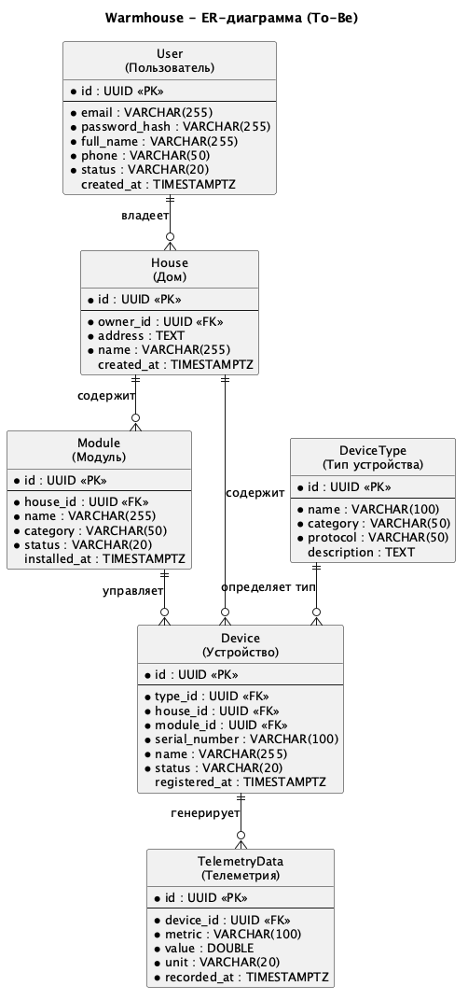

# Задание 1. Анализ и планирование

### 1. Описание функциональности монолитного приложения

Основная бизнес-функциональность текущего монолитного приложения ограничена управлением отоплением и мониторингом температуры в доме.

**Управление отоплением:**

- Пользователи могут удалённо включать и выключать отопление в своих домах через веб-интерфейс.
- Система отправляет команды управления от серверного приложения к установленному в доме отопительному оборудованию.
- В текущем решении не описана возможность задавать целевую температуру, выбирать режим отопления или настраивать расписание работы отопления.
- Подключение дома и оборудования к системе выполняется специалистом компании при выезде на объект.
- Пользователь не может самостоятельно подключить свой датчик или модуль отопления к системе.

**Мониторинг температуры:**

- Пользователи могут просматривать текущую температуру в доме через веб-интерфейс.
- Система получает данные о температуре с датчиков, установленных в доме пользователя.
- Получение данных происходит по запросу от сервера к датчику.
- Взаимодействие с датчиками синхронное: сервер отправляет запрос и ожидает ответ.
- Поле `value` у датчика отражает текущее показание датчика, а не целевую температуру отопления.
- Хранение исторической телеметрии, просмотр графиков и аналитика температуры в текущем решении не описаны.

### 2. Анализ архитектуры монолитного приложения

Текущее приложение реализовано как монолитный backend-сервис. В одном приложении находятся обработка HTTP-запросов, бизнес-логика, работа с датчиками и доступ к базе данных.

**Основные особенности текущей архитектуры:**

- **Язык программирования:** Go.
- **База данных:** PostgreSQL.
- **API:** HTTP API реализованно с использованием роутера Gin.
- **Хранение данных:** информация о датчиках хранится в таблице `sensors`.
- **Основная сущность:** `Sensor` - содержит название датчика, тип, расположение, текущее значение, единицу измерения, статус, время последнего обновления и дату создания.
- **Модель взаимодействия:** синхронная request-response модель.
- **Развёртывание:** приложение разворачивается как единый сервис. Изменение отдельной части системы требует пересборки и повторного развёртывания всего приложения.

**Взаимодействие между компонентами:**

Когда пользователь отправляет запрос через веб-интерфейс, его принимает HTTP API приложения. Затем запрос попадает в нужный обработчик: например, для получения списка датчиков, создания датчика или обновления его значения. Если обработчику нужны данные, он обращается к PostgreSQL. Если нужно получить актуальную температуру, приложение отправляет отдельный синхронный запрос к датчику. В коде приложения уже предусмотрен клиент `TemperatureService` для обращения к отдельному `temperature-api`. Сам `temperature-api` должен быть реализован далее в рамках задания 5 и будет имитировать получение температуры от датчика.

Все действия выполняются внутри одного приложения: оно принимает запросы пользователей, работает с базой данных и само обращается к датчикам за текущими значениями.

**Структура приложения по коду:**

- `main.go` отвечает за запуск приложения, подключение к базе данных, настройку роутера и регистрацию обработчиков.
- `db/db.go` содержит логику работы с PostgreSQL.
- `handlers/sensors.go` содержит HTTP-обработчики для работы с датчиками.
- `models/sensor.go` описывает модель датчика.
- `services/temperature_service.go` содержит клиент TemperatureService, предусмотренный для получения температуры через отдельный temperature-api..

### 3. Определение доменов и границы контекстов

Основной домен системы - **удалённое управление умным домом**. В текущем решении он реализован ограниченно: система поддерживает только управление отоплением и получение текущей температуры с датчиков.

**Поддомены As-Is:**

- **Управление отоплением**: включение и выключение отопления в доме пользователя.
- **Мониторинг температуры**: получение текущих показаний температуры с датчиков и отображение их пользователю.
- **Управление датчиками**: хранение информации о датчиках: тип, расположение, статус, текущее значение.
- **Подключение и обслуживание оборудования**: установка и подключение датчиков/модулей специалистами компании.
- **Связь пользователей, домов и оборудования**: в предметной области датчики и модули устанавливаются в конкретных домах пользователей. В текущем коде этот поддомен явно не выделен отдельными сущностями.

**Границы контекстов:**

- **Heating Management Context**: отвечает за команды управления отоплением и состояние отопительного оборудования.
- **Temperature Monitoring Context**: отвечает за получение и отображение текущей температуры.
- **Sensor Management Context**: отвечает за учёт подключённых температурных датчиков.
- **Equipment Installation Context**: отвечает за процесс установки и подключения оборудования специалистами.
- **House Equipment Context**: отвечает за связь пользователей, домов и установленного оборудования. В текущем монолите явно не выделен.

В целевой To-Be системе границы контекстов должны быть расширены: появятся отдельные контексты для управления освещением, воротами, видеонаблюдением, сценариями автоматизации, телеметрией, интеграцией устройств партнёров и самостоятельным подключением устройств пользователем.

### **4. Проблемы монолитного решения**

- **Сложность независимого развёртывания.** Любое изменение требует пересборки и повторного развёртывания всего приложения, даже если была изменена только одна часть системы. Это замедляет выпуск новых функций, которые нужны для расширения системы до полноценной системы умного дома.
- **Тесная связанность компонентов.** Обработка пользовательских запросов, бизнес-логика, работа с датчиками и доступ к данным находятся внутри одного приложения, поэтому изменения в одной части могут повлиять на другие. Данная проблема повышает риск регрессионных ошибок и усложняет тестирование изменений.
- **Ограниченная масштабируемость.** Нельзя отдельно масштабировать функции, которые испытывают большую нагрузку, например получение температуры с датчиков или управление отоплением. Необходимо масштабировать всё приложение целиком, что не подходит для роста числа домов, пользователей и добавления новых устройств.
- **Единая точка отказа.** Ошибка в одной части монолита может привести к нарушению работы всего приложения. Риск для бизнеса - недоступность всей услуги удалённого управления домом.
- **Зависимость от общей схемы данных.** Все функции приложения используют общую схему данных. Изменение структуры таблиц или проблемы с БД могут затронуть работу всего приложения. Это усложняет добавление новых типов устройств и сценариев.
- **Сложность развития системы.** Добавление новых возможностей умного дома, к примеру, освещения, ворот, видеонаблюдения, сценариев автоматизации и новых типов устройств, будет увеличивать размер и сложность одного общего приложения. Это замедляет развитие продукта и повышает стоимость изменений.
- **Синхронная модель взаимодействия текущего решения.** Сервер ожидает ответ от датчика в рамках пользовательского запроса. Если датчик отвечает медленно или недоступен, пользователь получает задержку или ошибку. При росте числа устройств эта проблема приведет к ухудшению пользовательского опыта.

### 5. Визуализация контекста системы — диаграмма С4

[Диаграмма контекста As-Is решения](diagrams/monolith/Context.puml)

# Задание 2. Проектирование микросервисной архитектуры

В этом задании вам нужно предоставить только диаграммы в модели C4. Мы не просим вас отдельно описывать получившиеся микросервисы и то, как вы определили взаимодействия между компонентами To-Be системы. Если вы правильно подготовите диаграммы C4, они и так это покажут.

[Диаграмма контекста To-Be микросервисной архитектуры](diagrams/microServices/context/Context.puml)

**Диаграмма контейнеров (Containers)**

[Диаграмма контейнеров To-Be микросервисной архитектуры](diagrams/microServices/container/Container.puml)

**Диаграмма компонентов (Components)**

[Диаграмма компонентов ключевых микросервисов](diagrams/microServices/component/Component.puml)

**Диаграмма кода (Code)**

[Диаграмма последовательности выполнения команды устройству](diagrams/microServices/code/Code.puml)

# Задание 3. Разработка ER-диаграммы

ER-диаграмма описывает логическую модель данных целевой (To-Be) экосистемы «Тёплый дом».

Исходный файл: [diagrams/er/ER.puml](diagrams/er/ER.puml)



### Ключевые сущности и атрибуты

| Сущность                      | Назначение                                                                                                                                    |
| ----------------------------- | --------------------------------------------------------------------------------------------------------------------------------------------- |
| `User` (Пользователь)         | Зарегистрированный пользователь системы. Атрибуты: `id`, `email`, `password_hash`, `full_name`, `phone`, `status`.                            |
| `House` (Дом)                 | Дом, принадлежащий пользователю. Атрибуты: `id`, `owner_id`, `address`, `name`.                                                               |
| `Module` (Модуль)             | Управляющий блок умного дома (например, модуль отопления, освещения, ворот). Атрибуты: `id`, `house_id`, `name`, `category`, `status`.        |
| `DeviceType` (Тип устройства) | Справочник типов устройств. Атрибуты: `id`, `name`, `category`, `protocol`.                                                                   |
| `Device` (Устройство)         | Физическое устройство или датчик, подключённое к модулю. Атрибуты: `id`, `type_id`, `house_id`, `module_id`, `serial_number`, `status`.       |
| `TelemetryData` (Телеметрия)  | Показания, генерируемые устройством (температура, состояние, события). Атрибуты: `id`, `device_id`, `metric`, `value`, `unit`, `recorded_at`. |

### Связи между сущностями

- **User - House** (один-ко-многим): один пользователь может владеть несколькими домами, каждый дом принадлежит одному пользователю.
- **House - Module** (один-ко-многим): в одном доме может быть установлено несколько модулей управления.
- **House - Device** (один-ко-многим): дом содержит несколько устройств; каждое устройство принадлежит одному дому.
- **Module - Device** (один-ко-многим): один модуль управляет несколькими устройствами.
- **DeviceType - Device** (один-ко-многим): тип устройства определяет категорию и протокол взаимодействия.
- **Device - TelemetryData** (один-ко-многим): одно устройство генерирует множество записей телеметрии.

# Задание 4. Создание и документирование API

### 1. Тип API

Укажите, какой тип API вы будете использовать для взаимодействия микросервисов. Объясните своё решение.

### 2. Документация API

Здесь приложите ссылки на документацию API для микросервисов, которые вы спроектировали в первой части проектной работы. Для документирования используйте Swagger/OpenAPI или AsyncAPI.

# Задание 5. Работа с docker и docker-compose

Перейдите в apps.

Там находится приложение-монолит для работы с датчиками температуры. В README.md описано как запустить решение.

Вам нужно:

1. сделать простое приложение temperature-api на любом удобном для вас языке программирования, которое при запросе /temperature?location= будет отдавать рандомное значение температуры.

Locations - название комнаты, sensorId - идентификатор названия комнаты

```
	// If no location is provided, use a default based on sensor ID
	if location == "" {
		switch sensorID {
		case "1":
			location = "Living Room"
		case "2":
			location = "Bedroom"
		case "3":
			location = "Kitchen"
		default:
			location = "Unknown"
		}
	}

	// If no sensor ID is provided, generate one based on location
	if sensorID == "" {
		switch location {
		case "Living Room":
			sensorID = "1"
		case "Bedroom":
			sensorID = "2"
		case "Kitchen":
			sensorID = "3"
		default:
			sensorID = "0"
		}
	}
```

1. Приложение следует упаковать в Docker и добавить в docker-compose. Порт по умолчанию должен быть 8081
2. Кроме того для smart_home приложения требуется база данных - добавьте в docker-compose файл настройки для запуска postgres с указанием скрипта инициализации ./smart_home/init.sql

Для проверки можно использовать Postman коллекцию smarthome-api.postman_collection.json и вызвать:

- Create Sensor
- Get All Sensors

Должно при каждом вызове отображаться разное значение температуры

Ревьюер будет проверять точно так же.
